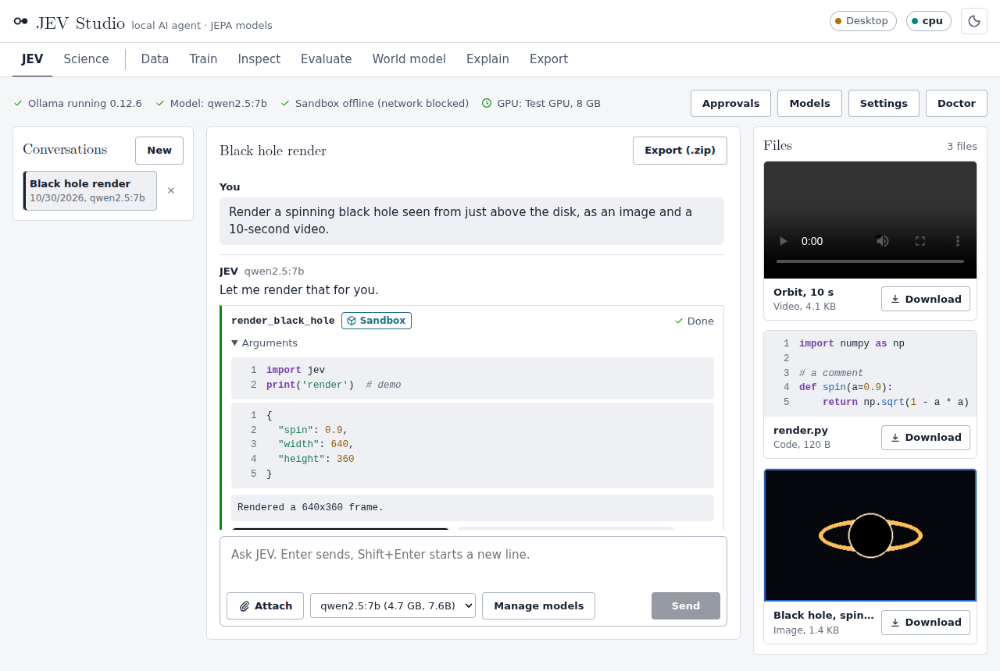
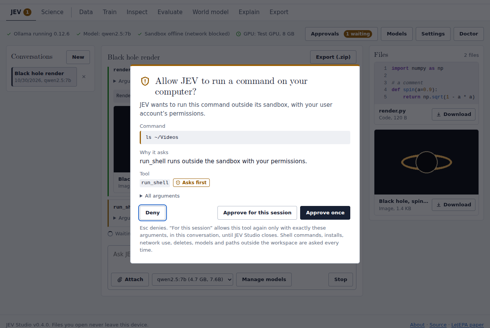
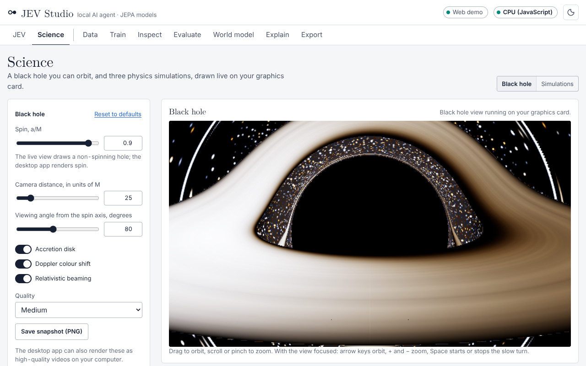
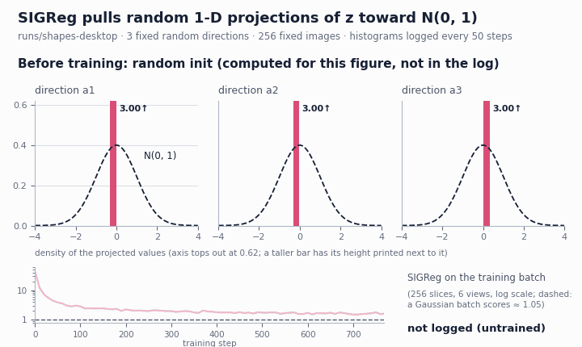
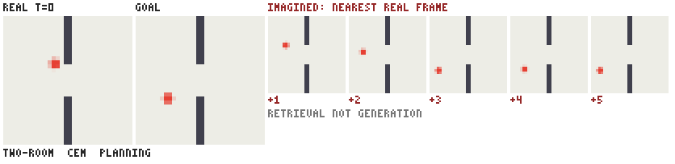
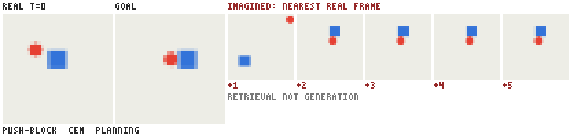

<p align="center">
  
</p>

# JEV Studio

**A local AI agent + JEPA models, on your own computer.** JEV answers questions, writes and runs
code, makes images and narrated videos, and simulates physics (the black hole above is one of its
renders), with language models served by your own [Ollama](https://ollama.com). Code runs in a
sandbox folder; anything beyond it stops and asks you. The same app pretrains, inspects and uses
LeJEPA self-supervised models on your unlabeled images, video or time series.

[](https://github.com/Normansrule/jev-jepa-studio/actions/workflows/ci.yml)
[](https://github.com/Normansrule/jev-jepa-studio/actions/workflows/pages.yml)
[](LICENSE)
[](https://securityscorecards.dev/viewer/?uri=github.com/Normansrule/jev-jepa-studio)

**[Download the desktop app](https://github.com/Normansrule/jev-jepa-studio/releases/latest)**
(Windows, macOS, Linux) ·
**[Try it in your browser](https://normansrule.github.io/jev-jepa-studio/app.html)** (the black
hole, the simulations and the JEPA demo run in the tab; JEV itself needs the desktop app)

---

## What JEV does

| | What you ask | What JEV does, locally |
|---|---|---|
| **Answer** | "Explain this paper", "What does this CSV say?" | reads the files you attach and quotes them; file contents are treated as data, never as instructions |
| **Code** | "Write and run code that fits this curve" | writes Python or Node.js, runs it in the conversation's sandbox folder with time and memory limits, reads the output, fixes errors |
| **Images** | "Plot …", "Make slides about …" | charts, diagrams, slides (Pillow, matplotlib), and image models you install yourself |
| **Video** | "Make a narrated video about …", "Find the best moments in my footage" | narrated explainers with local text-to-speech, highlight reels cut from your own clips (FFmpeg); [docs/jev/media.md](docs/jev/media.md) |
| **Physics** | "Render a spinning black hole", "Simulate a double pendulum" | a ray-traced Kerr black hole with Doppler beaming, N-body gravity, chaotic pendulums, waves, orbits; stills and MP4 |

Every tool call appears in the chat as a card with its risk level, its arguments, live progress,
the result and the files it made; the files collect in the conversation's gallery.



## The safety model, in short

* **Local only.** The model runs in Ollama on `127.0.0.1`; the backend listens on `127.0.0.1`
  with a per-session token. No telemetry, no hosted service, no account.
* **Three risk levels, decided by the backend, not the model.** *Read only* tools (answering,
  maths, listing the workspace) and *Sandbox* tools (writing and running code inside the
  conversation's folder, offline where the OS allows, with CPU, memory, time and output limits)
  run on their own. Everything else *asks first*: the network, files outside the workspace,
  shell commands, installing packages, downloading or deleting models, deleting conversations,
  long GPU jobs.
* **The approval safety net.** A focused dialog says what will happen, why it needs permission
  and the exact command, path or model, with Approve once, Approve for this session, or Deny
  (Esc). Session approvals are forgotten when the app closes. Unanswered requests are denied after
  30 minutes.
* **An audit log.** Every decision, including the automatic ones, is written to a local SQLite
  log you can read in the app (Approvals) or with `jev audit`.
* **Honest limits.** How strong the sandbox is depends on your operating system (for example,
  network isolation needs bubblewrap or unshare on Linux). [docs/jev/SAFETY.md](docs/jev/SAFETY.md)
  lists what each OS enforces, what is not enforced, and the test behind each claim.



## Install

1. **Ollama** (free, runs the language models): download it from
   <https://ollama.com/download>, or `brew install ollama` (macOS), `winget install Ollama.Ollama`
   (Windows), `curl -fsSL https://ollama.com/install.sh | sh` (Linux; read the script first if you
   like).
2. **A model** that can call tools: `ollama pull qwen2.5-coder:7b` (JEV's default, about 4.7 GB).
   Without a GPU, a 3B model such as `llama3.2:3b` (about 2 GB) is faster, at some cost in
   tool-calling quality. The table in
   [docs/jev/README.md](docs/jev/README.md#2-download-a-model) matches models to memory.
3. **The desktop app** from [Releases](https://github.com/Normansrule/jev-jepa-studio/releases/latest)
   (verify it against `SHA256SUMS.txt`). The first launch builds a private Python environment with
   PyTorch (a few GB); later launches take seconds. The setup window and the JEV tab's **Doctor**
   say whether Ollama is running and show the commands that fix what is missing.
   Details: [docs/desktop.md](docs/desktop.md).

From source instead (Python 3.10+):

```bash
git clone https://github.com/Normansrule/jev-jepa-studio && cd jev-jepa-studio
python -m venv .venv && source .venv/bin/activate     # Windows: .venv\Scripts\activate
pip install -e ".[jev]"                               # JEPA tools + JEV; extras: video, assistant, dev
jev doctor                                            # Ollama, models, sandbox, ffmpeg, GPU
jev chat "make a plot of sin(x) from 0 to 2 pi"       # one turn in the terminal
jepa-studio serve                                     # the app's backend on 127.0.0.1
```

## Science

The **Science** tab draws a black hole you can orbit (spin, distance, viewing angle, the disk,
Doppler colour and beaming) and three simulations (N-body gravity, a double pendulum, waves on a
membrane) live on your graphics card with WebGL, in the desktop app and on the website. The
desktop app can also render them on your computer as high-quality MP4 videos with a physically
based Kerr ray tracer; the physics and its approximations are written up in
[docs/jev/science.md](docs/jev/science.md).



## Web or desktop?

| | Website (browser tab) | Desktop app |
|---|---|---|
| Install | none | the app, plus Ollama and a model for JEV |
| JEV agent | no: it needs Ollama and a backend that can run code; the tab explains and links the download | yes, with sandbox and approvals |
| Science | live black hole and simulations (WebGL) | the same, plus video renders on your computer |
| JEPA compute | JavaScript; WebGPU for the first layer when verified correct and faster | PyTorch on CPU, CUDA, ROCm or Apple MPS |
| JEPA encoders | `mlp-tiny` (218 512 parameters, 16 × 16 inputs) | `convnet-tiny`, `convnet-small`, `vit-tiny`, `mlp-tiny`, `video-convnet`, `series-conv` |
| JEPA data | Shapes, local images (≤ 2000), CSV preview | images, video clips, time series (CSV/TSV/NPY), Shapes |
| Your files | decoded in the page, never uploaded | read from folders you grant; leave the machine only through a tool you approve |

## JEPA Studio: LeJEPA on your own data

LeJEPA is a Joint-Embedding Predictive Architecture (JEPA) trained with Sketched Isotropic
Gaussian Regularization (SIGReg): one loss, one knob, no teacher network
([Balestriero & LeCun, 2025](https://arxiv.org/abs/2511.08544)). The JEPA tabs show every step
(views, loss terms, embedding cloud, collapse check, probes, planning), run on whatever machine
you have, and write down every number and decision so you can check them.

| Tab | What you do there | Screenshot |
|---|---|---|
| **Data** | Pick Shapes, or choose, drop or paste your own images (a folder works) or a CSV; see one input next to its global and local views. | [tab-data](assets/screens/tab-data.png) |
| **Train** | Pick a preset or set steps, λ, learning rate and SIGReg directions (validated against the config schema); watch the loss terms live, with a health check and the hardware card. | [tab-train](assets/screens/tab-train.png) |
| **Inspect** | Explore the embedding cloud in 3-D or 2-D, read the collapse detector, browse nearest neighbours and saliency maps (plus [CLS] attention for ViT-tiny on desktop). | [tab-inspect](assets/screens/tab-inspect.png) |
| **Evaluate** | Freeze the encoder; fit a linear probe and a kNN classifier on a few labels; compare with random-init and supervised baselines. | [tab-evaluate](assets/screens/tab-evaluate.png) |
| **World model** | The Cross-Entropy Method (CEM) planner imagines in latent space, acts, replans; compare with random actions. | [tab-world](assets/screens/tab-world.png) |
| **Explain** | Optional. Passages quoted from these docs and your run log, with links; nothing is generated in the browser. | [tab-explain](assets/screens/tab-explain.png) |
| **Export** | Embeddings (CSV/`.npy`), weights (safetensors), the run report or a reproducibility bundle; edit and apply the run config as JSON. | [tab-export](assets/screens/tab-export.png) |

The command line does the same without the app (`jepa-studio <command> --help`):

```bash
jepa-studio doctor                                    # check the install
jepa-studio train --name shapes --epochs 2 --run-dir runs/my-shapes --eval
jepa-studio inspect --run-dir runs/my-shapes          # isotropy + collapse verdict
jepa-studio export  --run-dir runs/my-shapes          # HTML report + reproducibility bundle
jepa-studio world   --env two-room --out runs/my-two-room   # world model + planning bot
```

`hardware` benchmarks the machine and explains each automatic setting (precision, workers,
batch size under 85% of memory, thermal pause; [docs/hardware.md](docs/hardware.md)); `bench`
measures what each one buys; `sign-weights` / `verify-weights` handle Ed25519-signed manifests;
only safetensors weights are ever loaded.

### How LeJEPA works, in five sentences



1. An encoder turns several augmented views (crops) of the same input into embeddings, and a
   small projector maps them into the space where the loss is computed.
2. The prediction term asks every view's embedding to match the average embedding of the
   input's *global* views, so the model learns what stays the same across views; it predicts in
   embedding space, not pixels.
3. On its own that is solved by mapping everything to one point, so SIGReg projects each batch of
   embeddings onto random directions and uses the Epps–Pulley test to penalise any projection
   that doesn't look like a standard normal $\mathcal{N}(0, 1)$.
4. If every 1-D projection is standard normal, the whole cloud is the isotropic Gaussian
   $\mathcal{N}(0, I)$ (Cramér–Wold), which the paper argues is the best shape for whatever
   probe you fit later.
5. The loss is $(1-\lambda)\,\mathcal{L}_{\text{pred}} + \lambda\,\mathcal{L}_{\text{SIGReg}}$: one knob,
   and no Exponential Moving Average (EMA) teacher, stop-gradient, negative pairs or decoder.

| SIGReg at work | Predict embeddings, not pixels |
|---|---|
|  |  |

Every equation, exactly as coded, with worked examples that a test re-checks:
[docs/equations.md](docs/equations.md).

### The planning bot

A JEPA world model learns to predict the next frame's *embedding* from the current one and an
action (trained end-to-end from pixels with the same SIGReg, the LeWorldModel recipe). The CEM
planner searches for five-step action sequences whose imagined embeddings reach the goal image's
embedding, executes the first action, looks again and replans.

| two-room: go through the door | push-block: push the block to the goal |
|---|---|
|  |  |

The small frames on the right are **retrieved**, not generated: a JEPA has no decoder, so each
imagined embedding is shown as the nearest real frame. Each GIF shows the first evaluation
episode the planner solved; the success rates below are the representative numbers.
Details: [docs/world-model.md](docs/world-model.md).

### Results (real, small, CPU)

These come straight from files in this repo. They are **tiny CPU runs** meant to show the
method working end to end, not benchmarks.

**LeJEPA pretraining on Shapes** (`runs/shapes-desktop/eval.json`): `convnet-tiny` (382 128
parameters with the projector), 8192 images of 32 × 32 px, 12 epochs = 768 steps at batch 128,
λ = 0.05, 256 SIGReg directions, on a 2-core CPU with no GPU (`hardware.json`), 853 s. Evaluated
with 655 labeled images for the probe and 1638 images held out from the probe (all 8192 were
seen, unlabeled, during pretraining, as is usual for self-supervised evaluation); chance is 10%.

| Encoder | Linear probe | kNN (k = 20) | Effective rank (of 16) | Collapse check |
|---|---|---|---|---|
| LeJEPA (this run) | **47.7%** | 21.0% | 15.3 | healthy |
| random-init encoder (same architecture) | 17.9% | 12.8% | 2.6 | complete collapse |
| supervised on the 655 labels | 91.1% | 91.6% | 7.7 | healthy |

Honest reading:

* LeJEPA's features are far better than an untrained encoder (47.7% vs 17.9% linear probe) without
  ever seeing a label, but on this easy, labeled toy dataset **supervised training on 655 labels
  wins by a lot**. Twelve epochs on a laptop-class CPU, one seed, no tuning.
* kNN is only slightly above the random encoder: after this short run, cosine neighbourhoods in
  the backbone space are not yet organised by class, even though a linear probe finds the
  classes.
* The rank and collapse columns are computed on **projector** outputs. The supervised baseline
  never trains its projector, so those two columns say little about it. "Complete collapse" for
  the random encoder means its untrained projector outputs barely vary.
* The SIGReg values in `eval.json` (58.5 for LeJEPA) are computed over all 8192 images, and the
  statistic grows with the number of samples, so they are not comparable with the training-batch
  value (1.63 at step 768 over 128 samples, `events.jsonl`).

**World model + planner** (`runs/world-*/metrics.json`, 20 evaluation episodes, 40 steps max,
same episodes for both policies):

| Environment | CEM success | Random-action success | Mean final distance: CEM / random / at start | Training time |
|---|---|---|---|---|
| two-room | **80%** (16/20) | 15% | 0.144 / 0.380 / 0.428 | 134 s on 2 CPU threads |
| push-block | **25%** (5/20) | 0% | 0.189 / 0.158 / 0.151 | 104 s on 2 CPU threads |

two-room works. push-block is weak: when the planner fails it often pushes the block the wrong
way, so its mean final distance is worse than random and worse than doing nothing. The latent
encodes the block's position poorly (R² 0.19 / 0.38 in `metrics.json`). One seed, 20 episodes.

## Documentation

JEV: [overview and setup](docs/jev/README.md) ·
[safety model](docs/jev/SAFETY.md) ·
[HTTP API](docs/jev/api.md) ·
[the app's JEV and Science tabs](docs/jev/ui.md) ·
[media](docs/jev/media.md) ·
[science](docs/jev/science.md).

JEPA: [equations](docs/equations.md) ·
[data](docs/data.md) ·
[hardware](docs/hardware.md) ·
[world model](docs/world-model.md) ·
[web demo](docs/web-demo.md) ·
[local API](docs/api.md).

App and project: [desktop app](docs/desktop.md) ·
[security model](docs/SECURITY_MODEL.md) ·
[bibliography](docs/bibliography.md) ·
[reference repos](docs/references.md) ·
[visual style](docs/STYLE.md) ·
[contributing](CONTRIBUTING.md). Index: [docs/README.md](docs/README.md).

## Repository map

```
jev/                    JEV, the local agent: agent loop, policy (approvals), sandbox, Ollama client,
                          store (SQLite audit log), tools/, science/ (Kerr ray tracer, sims), media/
jepa_studio/            JEPA Studio: losses, models, training, hardware, evaluation, export,
                          the localhost server (mounts /api/jev), data loaders, world models
site/                   the web app (static; also the desktop front end): js/tabs/, js/jev/, js/science/
desktop/                Tauri desktop shell (JEV Studio)
schema/, configs/       config schema and examples
runs/                   real results quoted above
assets/                 README figures, renders and screenshots
docs/                   documentation (above); docs/jev/ for JEV
scripts/, tests/        docs-index builder and figure scripts; pytest suite (tests/js: Node checks)
```

## Security, in short

JEV's sandbox and approvals are summarized [above](#the-safety-model-in-short). For the rest of the
app:


* **Weights:** only safetensors are loaded; pickle checkpoints are refused (convert explicitly with
  `import-legacy`). Optional SHA-256 checks and Ed25519-signed manifests (`sign-weights`,
  `verify-weights`).
* **Datasets:** extension allowlist, no symlinks out of the chosen folder, decompression-bomb and
  size caps, `.npy` without pickle, CSV parsed as numbers only.
* **Desktop backend:** binds 127.0.0.1, per-session token, `Host` and `Origin` checks, JSON-only
  bodies capped at 2 MB, reads only folders you granted.
* **Explain assistant** (the JEPA docs helper, not JEV): retrieval first and extractive by default; untrusted log text is sanitised and
  marked; it has no tools, so injected instructions have nothing to act on.
* **Supply chain:** actions pinned by commit SHA, least-privilege workflow permissions,
  Dependabot, CodeQL, OpenSSF Scorecard and gitleaks.

What is **not** enforced yet (ONNX is export-only and never imported, no hash-locked Python
installs, the memory guard only counts this process, no thermal pause without sensors, and
more) is listed in
[docs/SECURITY_MODEL.md](docs/SECURITY_MODEL.md). Report vulnerabilities privately:
[SECURITY.md](SECURITY.md).

## Citing

To cite JEV Studio (the Python package is `jepa-studio`), use [CITATION.cff](CITATION.cff) (GitHub's "Cite this repository" button).
Please also cite the methods it implements:

```bibtex
@misc{balestriero2025lejepa,
  title         = {LeJEPA: Provable and Scalable Self-Supervised Learning Without the Heuristics},
  author        = {Balestriero, Randall and LeCun, Yann},
  year          = {2025},
  eprint        = {2511.08544},
  archivePrefix = {arXiv}
}

@misc{maes2026leworldmodel,
  title         = {LeWorldModel: Stable End-to-End Joint-Embedding Predictive Architecture from Pixels},
  author        = {Maes, Lucas and Le Lidec, Quentin and Scieur, Damien and LeCun, Yann and Balestriero, Randall},
  year          = {2026},
  eprint        = {2603.19312},
  archivePrefix = {arXiv}
}

@article{epps1983test,
  title   = {A test for normality based on the empirical characteristic function},
  author  = {Epps, T. W. and Pulley, Lawrence B.},
  journal = {Biometrika},
  volume  = {70},
  number  = {3},
  pages   = {723--726},
  year    = {1983},
  doi     = {10.1093/biomet/70.3.723}
}
```

Full, verified list: [docs/bibliography.md](docs/bibliography.md).

## License

MIT © 2026 Aleksander Norman ([LICENSE](LICENSE)).

* The LeJEPA and I-JEPA reference implementations are CC BY-NC 4.0 (non-commercial). No files
  from them are included. `losses.py` implements the paper's equations, but its Epps–Pulley
  quadrature (half line $[0, 3]$, 17 knots) follows the LeJEPA reference code rather than the
  paper's Algorithm 1 ($[-5, 5]$), and the class closely parallels the reference one, so if you
  need a licence-clean version for **commercial** use, have it reviewed or re-derived
  (details in the `losses.py` docstring). The world model
  is a re-implementation of the (MIT) LeWorldModel recipe. Per-repository details:
  [docs/references.md](docs/references.md).
* The weights in `runs/` and `site/models/` were trained by this project and are covered by the
  MIT license.
* The self-hosted Latin Modern fonts in `site/fonts/` are under the GUST Font License
  (`site/fonts/GUST-FONT-LICENSE.txt`).
