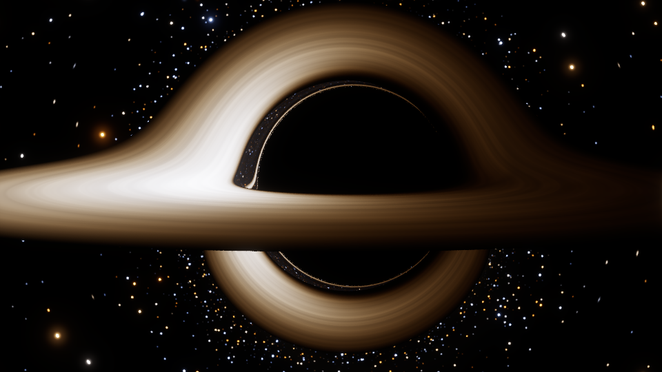
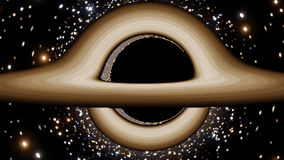
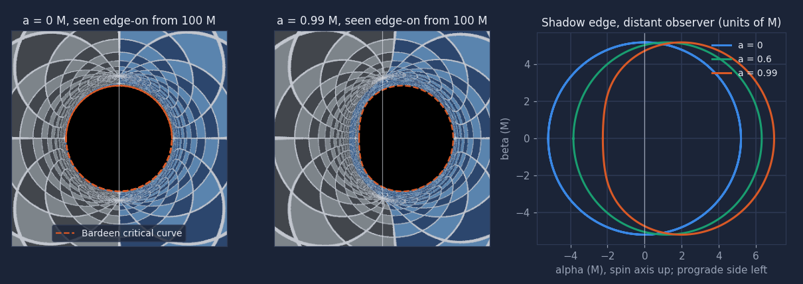

# JEV science: an Interstellar-style black hole and filmed physics

JEV can ray-trace a spinning black hole the way the black hole in *Interstellar* was made, and run
physics simulations that come with their own accuracy numbers. Everything runs locally: the
desktop renderer is Python (numpy + torch, on a CUDA GPU when one is present, otherwise the CPU),
and the web page has a real-time WebGL2 version.


*a = 0.6 M, camera at 40 M and 85° from the spin axis, Novikov–Thorne disk out to 20 M, rendered with
"Interstellar mode" (no Doppler colour shift or beaming), 960×540, 2×2 supersampling.*



*The physically complete version: the gas on the left is moving toward the camera at up to half the
speed of light, so it is blueshifted and far brighter; the right side is redshifted and dim.*



*The camera rising from 85° to 65°, re-traced every frame (preview quality). A 640×360 orbit video is
in [`assets/science/blackhole_orbit.mp4`](../../assets/science/blackhole_orbit.mp4).*



*Shadows rendered against a checker sky (disk off), edge-on from 100 M, with the analytic critical
curve (dashed) on top. Spin flattens the shadow on the side rotating toward the camera and shifts it
about 2.4 M the other way.*

| Where | Module | What |
|---|---|---|
| Kerr geometry, tracer | `jev/science/kerr.py` | horizon, ISCO, photon orbits, critical curve, ZAMO camera, Page–Thorne flux, vectorized geodesic integrator |
| Colour | `jev/science/color.py` | CIE 1931 fit → blackbody table → linear sRGB, ACES tone curve, bloom |
| Sky | `jev/science/background.py` | procedural lensed stars (point sources), checker grid |
| Renderer | `jev/science/blackhole.py` | `render(params, out_dir, progress, cancelled)` → PNG / MP4 / GIF + JSON |
| Simulations | `jev/science/sims.py` | `run(kind, params, out_dir, progress, cancelled)` → MP4 + chart + metrics JSON |
| Notes | `jev/science/notes.py` | the text `explain_black_hole_physics` returns |
| Agent tools | `jev/tools/science.py` | `render_black_hole`, `simulate_physics`, `explain_black_hole_physics` |
| Browser | `site/js/science/blackhole.js`, `sims.js`, `color.js` | WebGL2 black hole, canvas simulations |
| Tests | `tests/test_science_*.py`, `tests/js/science_sims.mjs` | the validation below |

## 1. The physics

Units are geometrized, $G = c = 1$, and the black-hole mass is $M = 1$, so lengths and times are in
units of $M$ ($1\,M = GM/c^2 \approx 1.5$ km per solar mass).

### Spacetime and light rays

The Kerr metric in Boyer–Lindquist coordinates $(t, r, \theta, \phi)$, with spin $a = J/M$, uses

$$\Sigma = r^2 + a^2\cos^2\theta,\qquad \Delta = r^2 - 2Mr + a^2,\qquad A = (r^2+a^2)^2 - a^2\Delta\sin^2\theta .$$

A photon has three conserved quantities (Carter 1968): energy $E$, axial angular momentum $L$ and
the Carter constant $Q$. With $b = L/E$, $q = Q/E^2$ and the Mino time $d\sigma = d\lambda/\Sigma$ the
geodesic equations separate:

$$\left(\frac{dr}{d\sigma}\right)^2 = R(r) = \left(r^2 + a^2 - ab\right)^2 - \Delta\left[(b-a)^2 + q\right]$$

$$\left(\frac{d\theta}{d\sigma}\right)^2 = \Theta(\theta) = q + a^2\cos^2\theta - b^2\cot^2\theta$$

$$\frac{d\phi}{d\sigma} = \frac{a\,(r^2 + a^2 - ab)}{\Delta} + \frac{b}{\sin^2\theta} - a,\qquad
\frac{dt}{d\sigma} = \frac{(r^2+a^2)(r^2+a^2-ab)}{\Delta} + a\,(b - a\sin^2\theta).$$

**How they are integrated.** The square roots in the first-order form need sign bookkeeping at every
radial and polar turning point. The renderer instead integrates the second-order form

$$\frac{d^2r}{d\sigma^2} = \tfrac12 R'(r),\qquad \frac{d^2\theta}{d\sigma^2} = \tfrac12\Theta'(\theta),$$

which passes smoothly through turning points, with an adaptive Dormand–Prince 5(4) method. Each ray has
its own step size, and all rays advance together as torch tensors, so a frame is one batched
computation (on the GPU when there is one). Finished rays are dropped from the batch as they go.
After each accepted step the velocities are projected back onto the exact first integrals,
$v_r \leftarrow \operatorname{sign}(v_r)\sqrt{R}$ and $v_\theta \leftarrow \operatorname{sign}(v_\theta)\sqrt{\Theta}$, except
near turning points. This matters for far cameras: at $r = 1000\,M$ the information about $b$ sits in a
relative difference of $10^{-6}$ between $v_r^2$ and $r^4$. Without the projection the shadow edge of an
$a = 0.99$ hole came out wrong by 2.5 M; with it, it agrees to $10^{-4}$ (section 3).

Termination per ray: **captured** when it is moving inward inside $r_+ + \tfrac12(r_{\rm ph}^{\rm pro} - r_+)$
(no radial turning point is left there); **escaped** when it is moving outward beyond
$\max(1.5\,r_{\rm cam}, 2\,r_{\rm out}, 100\,M)$. In that case the direction at infinity is the ray continued
as a straight line in the flat oblate-spheroidal coordinates that Boyer–Lindquist become for
$M \to 0$, plus the first-order remaining bending $\tfrac34 M l^3/r^4$ ($l^2 = q + b^2$). The residual is
below $10^{-6}$ rad. Rays that hit neither within the step budget are reported as `unresolved` in the
JSON (0 in every render below).

### The camera

As in James et al. (2015), the camera is at rest in the locally non-rotating frame of the
zero-angular-momentum observer (ZAMO, which they call the FIDO). Its lapse, frame-dragging angular
velocity and circumferential radius are

$$\alpha = \sqrt{\Sigma\Delta/A},\qquad \omega = 2aMr/A,\qquad \varpi = \sqrt{A/\Sigma}\,\sin\theta .$$

A pixel's direction $\mathbf n$ in the camera frame (forward $=-\mathbf e_r$, right $=\mathbf e_\phi$,
up $=-\mathbf e_\theta$, so the spin axis points up in the image) gives the photon's momenta for ZAMO
energy 1:

$$p_r = -n_r\sqrt{\Sigma/\Delta},\quad p_\theta = -n_\theta\sqrt{\Sigma},\quad L = -n_\phi\varpi,\quad E = \alpha + \omega L,$$

$$q = \frac{p_\theta^2 + \cos^2\theta\,(L^2/\sin^2\theta - a^2E^2)}{E^2}.$$

`camera_beta` moves the camera along $\mathbf e_\phi$ with speed $\beta$ relative to the ZAMO, which
applies special-relativistic aberration and a Doppler factor to every ray. The rays are traced
*backwards* (from the camera into the past).

### The accretion disk

The disk is geometrically thin and optically thick, in the equatorial plane between $r_{\rm in}$ and
$r_{\rm out}$. By default $r_{\rm in}$ is the innermost stable circular orbit (Bardeen, Press & Teukolsky 1972):

$$Z_1 = 1 + (1-a^2)^{1/3}\left[(1+a)^{1/3} + (1-a)^{1/3}\right],\quad Z_2 = \sqrt{3a^2 + Z_1^2},$$
$$r_{\rm isco} = 3 + Z_2 \mp \sqrt{(3 - Z_1)(3 + Z_1 + 2Z_2)}\quad(6M \text{ for } a=0,\ 1.237M \text{ for } a = 0.998).$$

**Temperature: Novikov–Thorne**, with the flux of Page & Thorne (1974). The closed form in $x = \sqrt{r/M}$
(with $x_0 = \sqrt{r_{\rm isco}}$ and $x_{1,2,3}$ the roots of $x^3 - 3x + 2a = 0$) is

$$F = \frac{3\dot M}{8\pi M^2}\,\frac{1}{x^4(x^3 - 3x + 2a)}\left[x - x_0 - \tfrac32 a\ln\frac{x}{x_0}
- \sum_{i}\frac{3(x_i - a)^2}{x_i(x_i - x_j)(x_i - x_k)}\ln\frac{x - x_i}{x_0 - x_i}\right],$$

and $T(r) = T_{\max}\,(F/F_{\max})^{1/4}$, where $T_{\max}$ is the parameter `disk.temperature_scale`. The flux is zero at
the ISCO (no torque on the inner edge), peaks just outside it and falls as $r^{-3/4}$ in temperature
far out. The code checks the closed form against a direct quadrature of the Page–Thorne integral,
$F = -\frac{\Omega_{,r}}{4\pi\sqrt{-g}(E-\Omega L)^2}\int_{r_{\rm isco}}^r (E - \Omega L)L_{,r}\,dr$
(they agree to $\le 7\times10^{-5}$ of the peak for $a \le 0.9$). `disk.profile: "power_law"` gives the
simpler $T \propto r^{-3/4}$ with a sharp inner edge instead.

Every crossing of the equatorial plane is located by Newton iteration on the cubic Hermite
interpolant of the accepted step. A crossing with $r_{\rm in} \le r \le r_{\rm out}$ is a disk hit. Any other
crossing (inside the ISCO or beyond the outer edge) lets the ray continue. This is what produces the
higher-order images: the far side of the disk bent over the top of the shadow, its underside bent
below it, and the thin photon ring that hugs the shadow (each extra half-orbit gives a fainter,
thinner copy). `disk.opacity < 1` makes the disk semi-transparent: up to three hits are composited
front to back.

### Frequency shift, colour and brightness

The gas follows prograde circular geodesics with $\Omega = 1/(r^{3/2} + a)$ and
$u^t = (r^{3/2} + a)/\left(r^{3/4}\sqrt{r^{3/2} - 3r^{1/2} + 2a}\right)$. A photon with $L = bE$ reaching a camera that
measures energy $E_{\rm cam}$ (for $E = 1$) has

$$g = \frac{\nu_{\rm obs}}{\nu_{\rm emit}} = \frac{E_{\rm cam}}{u^t\,(1 - \Omega b)}.$$

$g$ is split into a **gravitational** part, the lapse ratio $g_{\rm grav} = \alpha(r_{\rm emit})/\alpha(r_{\rm cam})$, and
the **Doppler** part $g/g_{\rm grav}$, which covers the orbital motion, frame dragging and any camera motion.

Since $I_\nu/\nu^3$ is invariant along a ray, a blackbody of temperature $T$ is seen as a blackbody of
temperature $gT$. The specific intensity scales as $I_\nu \propto g^3$, and the bolometric intensity as $g^4$.
The renderer therefore takes both colour and visible luminance from a blackbody at $gT$. The colour
is its CIE 1931 XYZ, integrated against Planck's law using the multi-lobe Gaussian fit of the
colour-matching functions by Wyman, Sloan & Shirley (2013), then converted to linear sRGB (D65).
This is computed once into a 512-entry table over $\log T$. The fit reproduces the Planckian locus to
better than $10^{-3}$ in $(x, y)$ (tested at 3000, 5000, 6500 and 10 000 K).

The toggles separate the effects:

| toggle | applies | to |
|---|---|---|
| `disk.redshift` | $g_{\rm grav}$ | colour and brightness |
| `disk.doppler` | $g/g_{\rm grav}$ | colour only |
| `disk.beaming` | $g/g_{\rm grav}$ | brightness only |
| `interstellar: true` | turns `doppler` and `beaming` off | |

**Interstellar mode.** James et al. (2015) write that the film's makers chose to omit the Doppler
shifts of the disk, so that the images would be understandable for a mass audience. Otherwise one
side of the disk is blue-white and much brighter than the other, as in the second image above. They
also lowered the spin to $a \approx 0.6$ for the disk shots. `interstellar: true` reproduces that choice;
the default keeps the physics complete.

### Sky and image

Escaped rays sample a procedural celestial sphere in their asymptotic direction. Stars are **point
sources**. For every pixel, the Jacobian $J$ of the lens map (pixel → sky) comes from neighbouring
rays, and a star adds $\text{flux}\cdot e^{-q/2}\cdot\mu$, where $q$ is its distance from the pixel in
*pixel* units and $\mu = \text{pixel}^2/|\det J|$ is the magnification. Star images therefore stay about one
pixel wide however strongly the sky is sheared, and their brightness follows the magnification. This
is the job James et al. do with ray bundles. Near the shadow one pixel covers many star cells; there
the layer's mean surface brightness is used, since lensing conserves surface brightness. A star close
to the point directly behind the hole is drawn as an Einstein ring. Captured rays are black. The HDR
image then goes through a mild lens bloom, auto-exposure (99.5th percentile) for stills (held fixed
across an animation), the ACES filmic curve and sRGB encoding.

**Animations.** For `animation: "orbit"` the camera circles the hole in azimuth. The spacetime and the
disk are axisymmetric, so one trace serves every frame: only the sky rotation and the disk pattern
change. The disk pattern rotates differentially at the Keplerian $\Omega(r)$ and is sampled at the
*emission* time $t_{\rm cam} - \Delta t_{\rm ray}$, using the coordinate-time delay integrated along every ray, so
light-travel-time effects are in. `zoom` and `inclination` re-trace every frame.

### What is approximated

* The disk is infinitely thin, stationary (apart from the cosmetic pattern) and emits isotropically
  as a blackbody. There is no limb darkening, no emission from the plunging region inside the ISCO,
  no returning radiation and no polarisation.
* The colour-matching functions are an analytic fit, not the tabulated CIE data (error < $10^{-3}$ in
  chromaticity).
* The stars and the faint band of light are procedural. Bloom is cosmetic.
* The browser version is limited to $a = 0$; see section 5.

## 2. Using it

### From JEV (the agent)

Ask in plain language, for example "render the Interstellar black hole as a 10-second video" or
"show me a double pendulum and how fast the two runs diverge". The model calls these tools:

| tool | risk | what |
|---|---|---|
| `render_black_hole` | sandbox; asks first if a timing probe estimates > 10 min or frames × pixels × samples > 1920×1080×240 | PNG still or MP4/GIF + parameters JSON in `<workspace>/science/` |
| `simulate_physics` | sandbox; asks if the estimate is > 10 min | MP4 + summary chart + metrics JSON |
| `explain_black_hole_physics` | read | the notes in `jev/science/notes.py` (topics: overview, geodesics, camera, disk, redshift, interstellar, shadow, limits, references) |

### From the HTTP API

`POST /api/jev/science/blackhole` with the render parameters, and
`POST /api/jev/science/simulate` with `{kind, params}` (see [api.md](api.md)). Progress and the files
arrive on `/api/jev/jobs/<id>/events`.

### From Python

```python
from pathlib import Path
from jev.science import blackhole, sims

files = blackhole.render({"spin": 0.6, "inclination_deg": 85, "distance_M": 40, "fov_deg": 46,
                          "width": 1920, "height": 1080, "quality": "final", "interstellar": True,
                          "disk": {"outer": 20, "temperature_scale": 5500}}, Path("out"))
video = blackhole.render({"frames": 144, "seconds": 6, "animation": "orbit"}, Path("out"))
files = sims.run("nbody", {"preset": "figure8"}, Path("out"))
```

### Render parameters

| key | default | meaning |
|---|---|---|
| `spin` | 0.6 | $a/M$, 0 to 0.999 |
| `inclination_deg` | 85 | camera angle from the spin axis (90 = in the disk plane) |
| `distance_M` | 28 | camera radius $r$ in units of $M$ |
| `fov_deg` | 55 | horizontal field of view |
| `width`, `height` | 640, 360 | rounded up to even numbers (H.264) |
| `disk` | see below | `inner` (ISCO), `outer` 16, `temperature_scale` 9000 K, `doppler`, `redshift`, `beaming` (true), `profile` (`novikov_thorne` / `power_law`), `opacity` 1, `texture` true, `enabled` true |
| `interstellar` | false | the film's look: no Doppler colour shift or beaming |
| `background` | `stars` | `stars`, `grid` (10° checker, shows the lens map) or `none` |
| `frames` | 1 | 1 = PNG; more = video |
| `seconds`, `fps` | 6, frames/seconds | video length |
| `animation` | `orbit` | `orbit` (`orbit_degrees` 90, traced once), `zoom` (to `zoom_to_M`), `inclination` (to `inclination_to_deg`) |
| `time_M_per_s` | 30 | coordinate time per video second (disk rotation speed) |
| `format` | `mp4` | `mp4` (H.264 via imageio-ffmpeg) or `gif` |
| `quality` | `preview` | `preview`: rtol 1e-5, 1 sample per pixel; `final`: rtol 1e-7, 2×2 stratified jittered samples |
| `camera_beta` | 0 | camera speed along $\mathbf e_\phi$ relative to the ZAMO |
| `exposure`, `bloom` | auto, by quality | tone mapping |
| `seed` | 0 | stars, disk pattern and sample jitter are deterministic for a seed |
| `device` | `auto` | `cuda` when torch sees a GPU, else `cpu` |

Invalid values raise `ValueError` with a readable message. A cancelled render (`cancelled()` returns
true) returns `[]` and leaves no partial video behind. `estimate_seconds(params)` runs a 24×14 timing
probe. The JSON next to every output records the parameters, the trace statistics (mean steps per ray,
unresolved rays), the exposure, timings, the device and reference radii (horizon, ISCO, photon orbits).

### Simulations

| kind | method | presets / params | metrics |
|---|---|---|---|
| `nbody` | velocity Verlet (kick-drift-kick leapfrog, symplectic), $G = 1$ | `figure8` (Chenciner & Montgomery 2000), `solar` (Sun + 4 planets, AU / yr), `cluster` (`n` bodies, Plummer sphere, softening 0.05, virialised) | energy drift, angular-momentum and momentum drift, figure-eight return error |
| `double_pendulum` (`pendulum`) | RK4, $g = 9.81$ | `theta1_deg`, `theta2_deg`, `delta` (twin offset, 1e-9 rad) | energy drift, separation growth, Lyapunov fit |
| `wave` | leapfrog in time, 5-point Laplacian; CFL number $C = c\,\Delta t\sqrt{1/\Delta x^2 + 1/\Delta y^2} \le 1$ is enforced | `pulse` (fixed edges), `double_slit`, `ripple` (absorbing sponge) | CFL number, the scheme's exactly conserved discrete energy $\tfrac12\lVert(u^{n+1}-u^n)/\Delta t\rVert^2 + \tfrac{c^2}2\langle\nabla u^{n+1},\nabla u^n\rangle$ |
| `orbit` | velocity Verlet or RK4 vs. Kepler's equation (Newton) | `a`, `e`, `orbits`; `gr: true` adds the Schwarzschild term ($u'' + u = M/h^2 + 3Mu^2$), `p_over_M` | position error, period error, energy drift; precession per orbit vs. the orbit equation integrated in $\phi$, and $6\pi M/p$ |
| `lorenz` | RK4, $\sigma = 10$, $\rho = 28$, $\beta = 8/3$ | `delta` | Lyapunov fit (reference 0.906) |

Common parameters: `seconds`, `fps`, `width`, `height`, `format`, `t_end`, `dt`, `seed`. The summary
chart needs matplotlib (optional, the `jev` extra). Without it you get the video and the metrics.

## 3. Validation (all numbers measured here; `python3 -m pytest -q tests/test_science_*.py`)

| check | expected | measured |
|---|---|---|
| Schwarzschild shadow, static observer, $\sin\alpha = 3\sqrt3 M\sqrt{1-2M/r}/r$ | r = 10 / 30 / 100 / 1000 M | relative error 2e-8 / 6e-8 / 3e-7 / 2e-6 (bracketing at rtol 1e-9) |
| shadow is round (inclined camera, vertical edge) | same radius | within 2e-4 (test tolerance) |
| photon sphere | $r = 3M$ | a ray $10^{-7}$ outside the critical angle skims $r_{\min}$ = 3.000 ± 2e-3 |
| ISCO | 6 M; 1.2370 M at a = 0.998; 9 M retrograde a = 1; minimum of $E(r)$ | all exact; $\arg\min E$ within 1e-4 |
| Kerr shadow, a = 0.99 edge-on, r = 1000 M | Bardeen curve edges (finite distance) | both edges within 2e-4; far-field $\alpha$ range −2.252…6.983 M vs measured −2.249…6.976 M; centre shifted 2.36 M toward the receding side |
| Kerr shadow, a = 0.9 at 60°, r = 50 M | critical curve | 7e-6 relative |
| weak-field deflection | $4M/b + 15\pi M^2/4b^2$ | 1.1e-3 relative at b = 100 M, 6.7e-5 at 400 M (the next term, $\tfrac{128}{3}M^3/b^3$, accounts for it) |
| a = 0 vs. scipy's independent $u'' + u = 3Mu^2$ | asymptotic $\phi$ | 7.5e-7 rad worst case for b = 7…20 M |
| conservation along a geodesic (raw integrator, a = 0.9) | $E$, $L$ from the metric; $Q$; $v_r^2 = R$ | $E$, $L$ to 1e-12; $Q$ and $R$ to < 1e-7 relative |
| Page–Thorne closed form vs. quadrature | equal | ≤ 7e-5 of the peak (a ≤ 0.9); Newtonian limit to 1e-3 |
| g factor | approaching side > 1, receding < 1; face-on far camera $g = \sqrt{1-3M/r}$ | yes; 2e-3 |
| rendered images | black centre, disk over and under the shadow, beaming asymmetry, Interstellar mode mirror-symmetric | yes (symmetric to 1e-6 of the peak for a = 0) |
| blackbody colour | Planckian locus | < 1e-3 in (x, y) |
| N-body figure-eight, one period, dt = 1e-3 | returns; energy | return error 7.9e-5; energy drift 5.9e-7; L and P to 1e-14 |
| leapfrog order | error ∝ dt² | ratio 3–5 when dt halves |
| double pendulum, RK4 dt = 1e-3, 12 s | energy; chaos | drift 9e-8; a 1e-9 rad offset grows > 1e5×; Lyapunov fit ≈ 1.0 /s |
| 2-D wave, CFL 0.5 | discrete energy; front speed $c$; CFL > 1 refused | constant to 6e-15; front at $ct$ ± 0.02; `ValueError` |
| Kepler orbit e = 0.6 | Kepler's equation | Verlet 2000 steps/orbit: position error 4e-3 over 3 orbits, period 1e-4; RK4 < 1e-4 |
| GR precession, p = 100 M, e = 0.6 | orbit equation in φ: 0.20492 rad/orbit ($6\pi M/p$ = 0.1885 is first order) | 0.20483 (5e-4) |
| Lorenz | λ ≈ 0.906 | 0.885 |
| browser (Node) | same bounds | figure-eight 7.9e-5 / 5.9e-7; wave energy 1e-14; colours equal to Python to 2e-4 |
| browser (Chromium, SwiftShader WebGL2) | shadow radius, black centre, disk arch, beaming, symmetry, no CSP errors | radius within 2 px; all pass |

## 4. Performance (measured on this machine: 2 CPU cores, no GPU)

| job | wall time | notes |
|---|---|---|
| preview still 320×180 (57 600 rays) | 2.7 s | rtol 1e-5, 26 steps per ray on average |
| preview still 640×360 | 9.2 s | |
| final still 640×360 (2×2 samples, 921 600 rays) | 60 s | rtol 1e-7, 58 steps per ray |
| final still 960×540 (2.07 M rays), the README image | 130–140 s trace + 3.6 s shading | 61 steps per ray, 0 unresolved |
| orbit MP4 640×360, final, 120 frames | 240 s | traced once (62 s), then 1.5 s per frame to shade and encode |
| orbit MP4 640×360, preview, 24 frames | 18 s | |
| zoom MP4 320×180, preview, 12 frames | 23 s | re-traced every frame |
| inclination-sweep GIF 400×226, preview | 3.0 s per frame | re-traced every frame |
| simulations (8 s, 640×480 video, defaults) | figure-eight 2.6 s, 40-body cluster 9.5 s, double pendulum 5.1 s, double slit 4.4 s, GR orbit 3.4 s, Lorenz 2.9 s | including frame drawing and H.264 encoding |
| browser, WebGL2 in SwiftShader (software rendering, no GPU) | a 960×540 "high" frame in about 0.2–0.3 s | on any real GPU it runs at interactive frame rates |

The runtime estimate behind the approval rule (`estimate_seconds`) uses a 32×18 probe trace for the
mean number of steps and a micro-benchmark of the geodesic right-hand side for this machine's cost per
step. Here it came out 0–35 % above the actual times; it errs long on purpose, since it decides when
to ask.

On a CUDA GPU the same code runs with `device: "cuda"`. The tracer is a few hundred batched tensor
operations per step, so expect it to be one to two orders of magnitude faster at 1080p (not measured
here: no GPU on this machine). Shading (stars, colour) stays on the CPU in numpy.

## 5. The browser version (`site/js/science/`)

`blackhole.js` traces one ray per pixel in a WebGL2 fragment shader, every frame.

* **Supported:** the Schwarzschild ($a = 0$) metric, exactly. Rays obey $u'' + u = 3Mu^2$, written as
  $\ddot{\mathbf x} = -3Mh^2\mathbf x/r^5$ and integrated by RK4 with steps proportional to $r$. The camera is a
  static observer with the correct aberration, so the shadow has the exact finite-distance size
  (checked in Chromium to 2 px). The disk has the Page–Thorne $a = 0$ temperature, Doppler / beaming /
  redshift toggles and Interstellar mode, and the same blackbody colour table as Python
  (`color.js`, tested for parity). Stars are point sources with Jacobian-based magnification (from
  `dFdx` / `dFdy`); the checker grid and no background are also available. Quality is low / medium /
  high (render scale 0.5 / 0.75 / 1 and 220 / 360 / 700 steps). You can orbit with drag, zoom with the
  wheel or a pinch, or use the keyboard (arrows, + / −, space to auto-rotate). It respects
  `prefers-reduced-motion` (no rotation or disk animation; it renders only on change).
* **Desktop only:** spin (frame dragging, the asymmetric Kerr shadow), light-travel-time delays,
  supersampling and video output. `capabilities.spin === false` tells the UI to say so.
* **Without WebGL2** `mountBlackHole` throws an `Error` whose message mentions WebGL2, so the caller
  can show its own fallback. Pass `fallback: 'message'` to draw a message on the canvas instead.

```js
import { mountBlackHole, capabilities, shadowAngle } from './science/blackhole.js';
const bh = mountBlackHole(canvas, {
  distance: 28, inclination: 85, azimuth: 0, fov: 55,          // camera (M, degrees)
  disk: true, diskInner: 6, diskOuter: 16, temperature: 6000,  // disk (M, K)
  doppler: true, beaming: true, redshift: true, interstellar: false,
  background: 'stars', quality: 'medium', exposure: 1,
  autoRotate: false, animateDisk: true, timeScale: 20,
  reducedMotion: matchMedia('(prefers-reduced-motion: reduce)').matches,
  onChange: (p) => {},          // after the user orbits or zooms
});
bh.setParams({ inclination: 70 }); bh.getParams(); bh.render();
const png = await bh.snapshot();  // Blob (image/png)
bh.destroy();
```

`sims.js` runs canvas simulations: `nbody` (`bodies`: 3 gives the figure-eight, more a cluster;
`speed`), `double_pendulum` (`theta1`, `theta2`, `massRatio`, `speed`; a twin starts 1e-5 rad away),
`wave` (`speed`, `damping`, `freq`; two sources and an absorbing border; click to drop a pulse), `orbit`
and `lorenz`.

```js
import { mountSim } from './science/sims.js';
const sim = mountSim(canvas, 'double_pendulum', { theta1: 120, theta2: -20, reducedMotion: false });
sim.setParams({ speed: 2 }); sim.pause(); sim.start(); sim.step(60); sim.reset();
sim.metrics();   // {t, energy_rel_error, separation, ...}
sim.destroy();
```

With reduced motion a simulation does not animate by itself. It jumps ahead and draws the state with
its trails, and `start()` plays it on request. The physics functions (`nbodyStep`, `pendulumRHS`,
`rk4`, `createWave`, `waveStep`, `waveEnergy`, `courant`, `keplerPosition`, `lorenzRHS`) are exported
and DOM-free. Neither module uses inline scripts or `eval`; shader sources are JS strings; they work
under the app's `script-src 'self'` CSP.

## 6. References

All checked in October 2026.

* O. James, E. von Tunzelmann, P. Franklin, K. S. Thorne, "Gravitational lensing by spinning black
  holes in astrophysics, and in the movie *Interstellar*", *Class. Quantum Grav.* **32**, 065001 (2015),
  [doi:10.1088/0264-9381/32/6/065001](https://doi.org/10.1088/0264-9381/32/6/065001),
  [arXiv:1502.03808](https://arxiv.org/abs/1502.03808). Source for the ZAMO/FIDO camera, backward ray
  tracing, the omitted Doppler shifts and the a ≈ 0.6 spin used for the film's disk.
* J.-P. Luminet, "Image of a spherical black hole with thin accretion disk", *Astron. Astrophys.* **75**,
  228–235 (1979). The first computed image of a lensed thin disk.
* B. Carter, "Global structure of the Kerr family of gravitational fields", *Phys. Rev.* **174**, 1559
  (1968), [doi:10.1103/PhysRev.174.1559](https://doi.org/10.1103/PhysRev.174.1559). The Carter constant.
* J. M. Bardeen, W. H. Press, S. A. Teukolsky, "Rotating black holes: locally nonrotating frames, energy
  extraction, and scalar synchrotron radiation", *ApJ* **178**, 347 (1972),
  [doi:10.1086/151796](https://doi.org/10.1086/151796). ZAMO frame, circular orbits, ISCO.
* J. M. Bardeen, "Timelike and null geodesics in the Kerr metric", in *Black Holes (Les Houches 1972)*,
  eds. C. DeWitt and B. S. DeWitt, Gordon and Breach, p. 215 (1973). The shadow's critical curve.
* D. N. Page, K. S. Thorne, "Disk-accretion onto a black hole. Time-averaged structure of accretion
  disk", *ApJ* **191**, 499 (1974), [doi:10.1086/152990](https://doi.org/10.1086/152990).
* C. Wyman, P.-P. Sloan, P. Shirley, "Simple analytic approximations to the CIE XYZ color matching
  functions", *J. Computer Graphics Techniques* **2**(2), 1–11 (2013).
* A. Chenciner, R. Montgomery, "A remarkable periodic solution of the three-body problem in the case of
  equal masses", *Ann. Math.* **152**, 881 (2000). The figure-eight initial conditions.
* E. N. Lorenz, "Deterministic nonperiodic flow", *J. Atmos. Sci.* **20**, 130 (1963).
* R. Courant, K. Friedrichs, H. Lewy, "Über die partiellen Differenzengleichungen der mathematischen
  Physik", *Math. Ann.* **100**, 32 (1928). The CFL condition.
